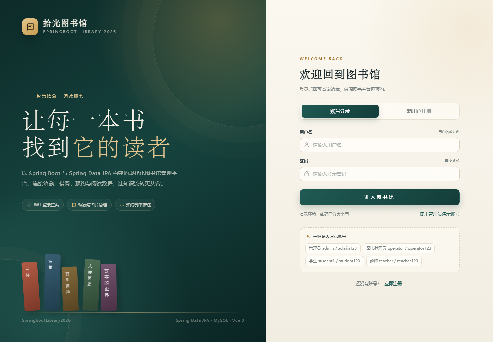
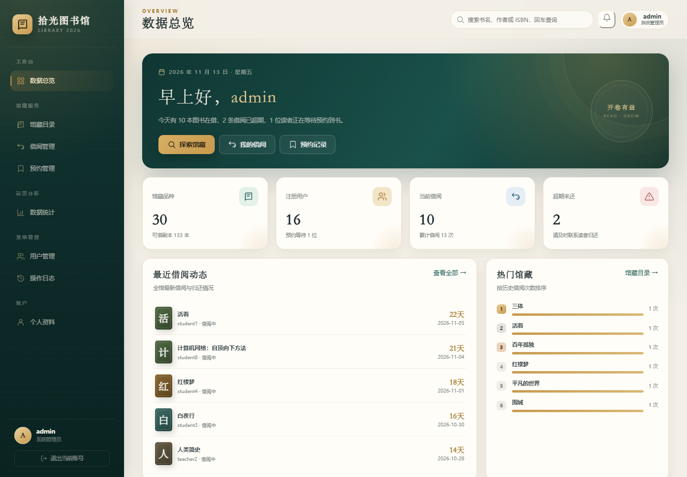
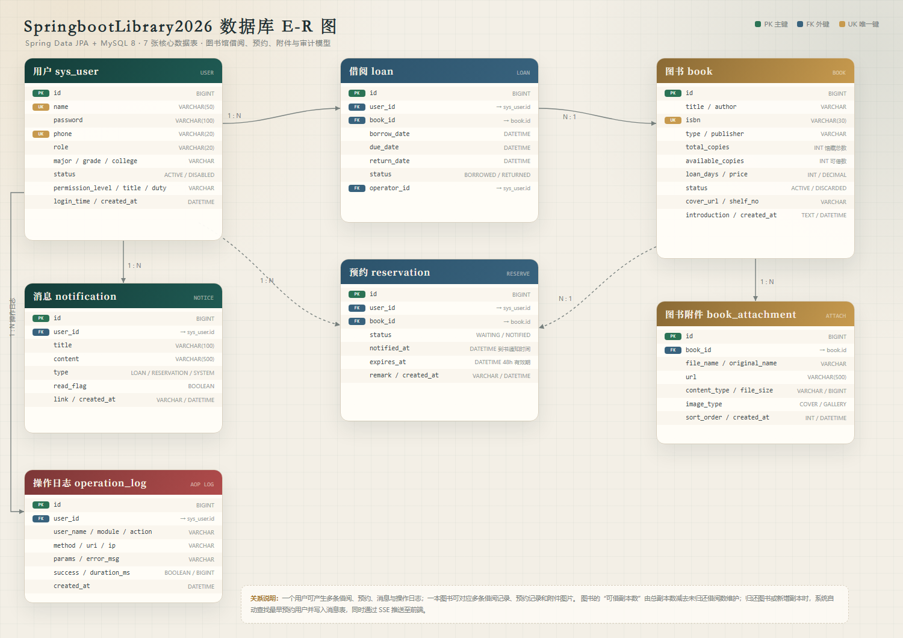

# SpringbootLibrary2026 · 拾光图书馆

基于 **Spring Boot 3 + Spring Data JPA + MySQL 8 + Vue 3 + Axios** 的前后端分离图书馆管理系统，为《Java Web 应用开发》课程作业 3 实现。

- 后端：Spring Boot 3.3.5、Spring Data JPA、MySQL、JWT、Spring AOP、SSE
- 前端：Vue 3（本地引入，无构建依赖）、Axios、原生 CSS，可独立部署在 Tomcat / Nginx
- 数据库：MySQL 8.4，7 张核心业务表
- 打包：普通可执行 Jar + 外部 `lib/` 依赖目录，实现依赖与代码分离





## 一、功能清单

### 1. 用户功能

- 用户注册：用户名、密码、手机号、角色与角色专属信息；用户名与手机号唯一校验；密码 BCrypt 加密。
- 用户登录：JWT 令牌登录，登录失败提示明确；支持退出登录。
- 用户查询（管理员）：按用户名/手机号/专业关键字、角色、状态、专业组合查询，服务端分页，默认每页 10 条。
- 用户详情：查看学生/教师/图书管理员/管理员的不同角色档案。
- 用户启停：管理员可停用或启用账号，停用后该账号无法登录和访问受保护接口。

### 2. 图书功能

- 馆藏查询：书名、作者、ISBN、出版社模糊查询，按分类、状态、是否可借组合筛选。
- 服务端分页：所有用户查询、图书查询、借阅查询、预约查询、日志查询均由后端分页，页面默认 10 条。
- 新增 / 编辑 / 下架 / 上架 / 删除图书。
- 馆藏数量与可借数量自动维护：新增副本、编辑总数、借书、还书都会同步更新；存在未归还副本时不允许下架或删除。
- 图书封面与相关图片：
  - 封面单独上传，列表页、详情页、借阅记录中展示。
  - 可为每本图书上传一组相关图片（最多 12 张），详情弹窗中支持大图预览与左右切换。
  - 附件表 `book_attachment` 通过 `book_id` 关联图书，通过 `image_type` 区分 `COVER` / `GALLERY`。
- 借书与还书：查看可借馆藏直接借阅；还书后副本自动归还，并触发预约队列通知。

### 3. 预约与消息推送

- 当图书 `available_copies = 0` 时，读者可以发起预约，进入等待队列。
- 其他读者归还图书、或管理员新增副本后，后端自动查找最早预约用户：
  - 将预约状态改为 `NOTIFIED`；
  - 写入 `notification` 消息表；
  - 通过 **SSE（Server-Sent Events）** 实时推送到前端右上角消息中心；
  - 通知有效期 48 小时。
- 前端的消息中心显示未读数量、消息列表、实时连接状态，并支持全部已读。

### 4. 数据统计（选做，已实现）

- 馆藏品种、副本总量、可借副本、注册用户、累计借阅、在借数量、超期数量、预约等待数。
- 近六个月借阅趋势柱状图。
- 馆藏分类结构、分类借阅热度、用户角色构成、热门借阅排行、最近借阅动态。

### 5. 登录拦截与权限

- `AuthInterceptor` 对 `/api/**` 全部接口进行 JWT 拦截。
- 放行登录、注册、健康检查；SSE 接口支持通过 `?token=` 传递令牌。
- 通过自定义注解 `@RequireRole` 在方法或控制器上声明角色权限：
  - `ADMIN`：用户管理、操作日志、全部功能
  - `OPERATOR`：图书管理、借阅管理、预约管理、数据统计
  - `STUDENT` / `TEACHER`：馆藏查询、借阅、还书、预约、个人记录
- 未登录返回 401，权限不足返回 403，账号停用返回 403。

### 6. AOP 操作日志

- 自定义注解 `@LogOperation(module, action, description, saveParams)`。
- `OperationLogAspect` 环绕通知自动记录：
  - 操作人、模块、动作、描述；
  - 请求方法、URI、IP；
  - 参数摘要（登录/注册不记录密码）；
  - 成功/失败、异常信息、耗时；
  - 操作时间。
- 管理员可在「操作日志」中按模块、关键字、结果、日期范围组合查询。

## 二、技术栈

| 层次 | 技术 |
| --- | --- |
| 后端框架 | Spring Boot 3.3.5 |
| 数据访问 | Spring Data JPA / Hibernate 6.5 |
| 数据库 | MySQL 8.4 |
| 登录认证 | JJWT 0.12.6 + 自定义 HandlerInterceptor |
| 密码加密 | Spring Security Crypto（BCrypt） |
| 操作日志 | Spring AOP + 自定义注解 |
| 实时消息 | SSE（SseEmitter） |
| 前端 | Vue 3.4（本地生产版）、Axios、原生 CSS |
| 构建 | Maven 3.9，JDK 17+ |
| 前端部署 | Apache Tomcat 9+ / 任意静态 Web 服务器 |

## 三、项目结构

```text
SpringbootLibrary2026
├── pom.xml
├── README.md
├── sql/
│   └── springboot_library_2026.sql        # 数据库结构与演示数据
├── docs/
│   ├── ER.md                              # E-R 说明与 Mermaid 图
│   ├── er-diagram.html                    # 可视化 E-R 图源文件
│   ├── er-diagram.png                     # E-R 图图片
│   └── login-page.png                     # 登录页截图
├── frontend/                              # 独立前端工程（复制到 Tomcat 即可）
│   ├── index.html
│   ├── config.js
│   ├── css/app.css
│   ├── js/api.js
│   ├── js/app.js
│   ├── lib/vue.global.prod.js
│   ├── lib/axios.min.js
│   └── assets/logo.svg
├── scripts/
│   ├── package.bat                        # 构建并生成 dist 分离包
│   ├── start-backend.bat
│   ├── deploy-frontend.bat
│   └── init-db.bat
└── src/main/
    ├── java/edu/chenjin/library/
    │   ├── SpringbootLibrary2026Application.java
    │   ├── aspect/                        # AOP 日志注解与切面
    │   ├── common/                        # Result、分页、异常、当前用户上下文
    │   ├── config/                        # Web 配置、演示数据初始化
    │   ├── controller/                    # REST 控制器
    │   ├── dto/                           # 请求 / 响应对象
    │   ├── entity/                        # JPA 实体
    │   ├── repository/                    # Spring Data JPA 仓库
    │   ├── security/                      # JWT、拦截器、角色注解
    │   └── service/                       # 业务服务
    └── resources/application.yml
```

## 四、快速运行

### 1. 环境要求

- JDK 17 或更高版本（本项目在 JDK 21 下验证）
- Maven 3.9+
- MySQL 8.0+
- Apache Tomcat 9+（用于部署前端静态页面）

### 2. 初始化数据库

数据库默认名为 `springboot_library_2026`，JPA 配置为 `ddl-auto: update`，首次启动会自动建表并写入演示数据。

也可以先手动导入 SQL：

```bash
mysql -uroot -p < sql/springboot_library_2026.sql
```

默认数据库配置在 `src/main/resources/application.yml`：

```yaml
spring:
  datasource:
    url: jdbc:mysql://localhost:3306/springboot_library_2026?createDatabaseIfNotExist=true&...
    username: ${DB_USERNAME:root}
    password: ${DB_PASSWORD:24011868cj}
```

建议通过环境变量覆盖，不要把个人密码提交到仓库：

```bat
set DB_USERNAME=root
set DB_PASSWORD=你的数据库密码
set UPLOAD_DIR=./uploads
set JWT_SECRET=请替换为至少 32 字符的随机密钥
```

### 3. 构建后端（依赖与代码分离）

在项目根目录执行：

```bash
mvn clean package -DskipTests
```

构建结果：

```text
target/
├── SpringbootLibrary2026.jar    # 只包含项目代码，Manifest 中通过 Class-Path 引用 lib/
└── lib/                         # 全部运行时依赖
```

也可以运行：

```bat
scripts\package.bat
```

生成可直接拷贝运行的独立发行目录：

```text
dist/SpringbootLibrary2026/
├── SpringbootLibrary2026.jar
├── lib/
├── frontend/
├── sql/
├── start-backend.bat
├── deploy-frontend.bat
└── README.md
```

### 4. 启动后端

必须在 Jar 所在目录启动（保证 `lib/` 与 `uploads/` 相对路径正确）：

```bash
java -jar target/SpringbootLibrary2026.jar
```

后端地址：`http://localhost:8081`
健康检查：`http://localhost:8081/api/auth/health`

> 依赖分离的核心：`maven-jar-plugin` 在 Manifest 中写入 `Class-Path: lib/xxx.jar ...`，`maven-dependency-plugin` 将运行时依赖复制到 `target/lib`。因此 Jar 很小，升级依赖时只需替换 `lib/` 中的 Jar。

### 5. 部署前端到 Tomcat

把 `frontend/` 目录整体复制为 Tomcat 的 Web 应用：

```bat
set TOMCAT_HOME=E:\java\tomcat\apache-tomcat-9.0.123
scripts\deploy-frontend.bat
```

或手动复制：

```text
%TOMCAT_HOME%\webapps\library2026\index.html
%TOMCAT_HOME%\webapps\library2026\css\...
...
```

启动 Tomcat 后访问：

```text
http://localhost:8080/library2026/
```

前端 `config.js` 默认按“当前访问主机 + 8081 端口”拼接后端地址，因此本机和局域网访问都不需要改代码。若后端不在 8081，可在浏览器控制台执行：

```javascript
localStorage.setItem('library_api_base', 'http://192.168.1.10:8081/api');
location.reload();
```

### 6. 演示账号

| 角色 | 用户名 | 密码 |
| --- | --- | --- |
| 系统管理员 | `admin` | `admin123` |
| 图书管理员 | `operator` | `operator123` |
| 学生 | `student1` | `student123` |
| 教师 | `teacher` | `teacher123` |
| 其他演示学生 | `student2` ~ `student10` | `student123` |

## 五、接口一览

统一响应：

```json
{ "code": 200, "message": "操作成功", "data": {} }
```

| 方法 | 路径 | 说明 | 权限 |
| --- | --- | --- | --- |
| POST | `/api/auth/login` | 登录 | 匿名 |
| POST | `/api/auth/register` | 注册 | 匿名 |
| GET | `/api/auth/me` | 当前用户 | 登录 |
| POST | `/api/auth/logout` | 退出 | 登录 |
| GET | `/api/users` | 用户分页查询 | ADMIN |
| GET | `/api/users/{id}` | 用户详情 | ADMIN |
| PUT | `/api/users/{id}/status` | 启用/停用用户 | ADMIN |
| GET | `/api/books` | 图书分页查询 | 登录 |
| GET | `/api/books/{id}` | 图书详情与附件 | 登录 |
| POST | `/api/books` | 新增图书 | ADMIN/OPERATOR |
| PUT | `/api/books/{id}` | 编辑图书 | ADMIN/OPERATOR |
| PUT | `/api/books/{id}/status` | 上下架 | ADMIN/OPERATOR |
| DELETE | `/api/books/{id}` | 删除图书 | ADMIN/OPERATOR |
| POST | `/api/books/{id}/cover` | 上传封面 | ADMIN/OPERATOR |
| POST | `/api/books/{id}/gallery` | 上传相关图片 | ADMIN/OPERATOR |
| DELETE | `/api/books/{id}/gallery/{attachmentId}` | 删除图片 | ADMIN/OPERATOR |
| POST | `/api/loans/borrow` | 借书 | 登录 |
| POST | `/api/loans/{id}/return` | 还书 | 登录/本人或管理员 |
| GET | `/api/loans/my` | 我的借阅分页 | 登录 |
| GET | `/api/loans` | 全部借阅分页 | ADMIN/OPERATOR |
| POST | `/api/reservations` | 预约图书 | 登录 |
| GET | `/api/reservations/my` | 我的预约分页 | 登录 |
| GET | `/api/reservations` | 全部预约分页 | ADMIN/OPERATOR |
| DELETE | `/api/reservations/{id}` | 取消预约 | 登录/本人或管理员 |
| GET | `/api/notifications` | 通知分页 | 登录 |
| GET | `/api/notifications/latest` | 最近通知 | 登录 |
| GET | `/api/notifications/unread-count` | 未读数 | 登录 |
| POST | `/api/notifications/{id}/read` | 单条已读 | 登录 |
| POST | `/api/notifications/read-all` | 全部已读 | 登录 |
| GET | `/api/notifications/stream?token=` | SSE 实时消息 | 登录 |
| GET | `/api/stats/overview` | 总览统计 | ADMIN/OPERATOR |
| GET | `/api/stats/monthly` | 月度趋势 | ADMIN/OPERATOR |
| GET | `/api/stats/book-types` | 馆藏分类 | ADMIN/OPERATOR |
| GET | `/api/stats/loan-types` | 分类借阅 | ADMIN/OPERATOR |
| GET | `/api/stats/top-books` | 热门排行 | ADMIN/OPERATOR |
| GET | `/api/stats/roles` | 用户角色构成 | ADMIN/OPERATOR |
| GET | `/api/stats/recent-loans` | 最近借阅 | ADMIN/OPERATOR |
| GET | `/api/logs` | 操作日志分页 | ADMIN |

## 六、数据库 E-R 图



Mermaid 版本见 [docs/ER.md](docs/ER.md)。

核心表：

- `sys_user`：用户与角色扩展信息
- `book`：图书基础信息、馆藏总数、可借数、封面 URL
- `book_attachment`：图书附件表，`image_type` 区分封面与相关图片
- `loan`：借阅记录，`status = BORROWED / RETURNED`，超期由 `due_date` 动态计算
- `reservation`：预约记录，`WAITING → NOTIFIED → FULFILLED / CANCELLED`
- `notification`：消息表，记录借阅、预约到书、系统通知
- `operation_log`：AOP 操作日志

附件表设计要点：

1. 一本书对应多条附件记录，而不是在 `book` 表里存图片列表字符串；
2. `image_type` 区分 `COVER` 与 `GALLERY`，封面可以单独查询和替换；
3. `sort_order` 控制相关图片展示顺序；
4. 删除图书或图片时同步删除磁盘文件与附件记录；
5. 封面 URL 冗余在 `book.cover_url` 中，列表查询无需关联附件表，提高分页性能。

## 七、关键实现说明

### 服务端分页与多条件组合查询

所有列表接口使用 Spring Data JPA `Specification` 动态拼接条件，`PageRequest` 实现服务端分页。前端每次查询传 `page`、`size` 以及组合条件，默认 `page=1&size=10`。

```java
Page<Book> result = bookRepository.findAll(specification,
        PageRequest.of(pageIndex, pageSize, Sort.by(Sort.Direction.DESC, "createdAt")));
```

### 预约到书推送流程

```text
读者预约（无库存） → reservation.status = WAITING
        ↓
其他读者还书 / 管理员新增副本 → book.available_copies > 0
        ↓
ReservationService.notifyNextWaiting()
        ↓
找到最早 WAITING 记录 → status = NOTIFIED、expires_at = now + 48h
        ↓
写入 notification 表 → NotificationService 推送到 SseEmitter
        ↓
前端 EventSource 收到 notification 事件 → 右上角消息中心 + Toast 提醒
```

### AOP 日志

```java
@PostMapping("/borrow")
@LogOperation(module = "借阅", action = "借书", description = "借阅图书")
public Result<LoanView> borrow(@Valid @RequestBody BorrowRequest request) { ... }
```

切面自动以 `REQUIRES_NEW` 事务写入日志，业务异常不会导致日志丢失。

## 八、局域网运行与视频演示

1. 查询本机 IPv4：

```bat
ipconfig
```

2. 放行端口（管理员 PowerShell）：

```powershell
New-NetFirewallRule -DisplayName "Library Backend 8081" -Direction Inbound -Protocol TCP -LocalPort 8081 -Action Allow
New-NetFirewallRule -DisplayName "Tomcat 8080" -Direction Inbound -Protocol TCP -LocalPort 8080 -Action Allow
```

3. 同一局域网内的设备访问：

```text
http://192.168.x.x:8080/library2026/
```

前端会自动把 API 地址拼接为 `http://192.168.x.x:8081/api`。

4. 建议视频演示顺序：
   - 登录页与 JWT 拦截（未登录直接访问接口返回 401）
   - 管理员登录 → 工作台数据总览
   - 图书查询：组合条件 + 分页（默认 10 条）
   - 新增图书 + 上传封面/相关图片 + 查看大图
   - 学生借书、还书
   - 学生预约无库存图书 → 管理员归还同一本书 → 学生端消息中心实时弹出到书通知
   - 用户查询与停用账号
   - 操作日志查看 AOP 记录
   - 数据统计图表
   - 展示 `target/SpringbootLibrary2026.jar` 与 `target/lib` 分离打包结果
   - 通过局域网 IP 在另一台设备访问前端

## 九、代码仓库

项目已初始化为 Git 仓库，按功能阶段形成提交记录，并已推送到远程仓库：

```text
https://github.com/LQX883/SpringbootLibrary2026
```

克隆方式：

```bash
git clone https://github.com/LQX883/SpringbootLibrary2026.git
```

若课程要求提交到 Gitee，可直接把同一仓库推送到 Gitee 作为镜像，提交记录完全一致：

```bash
git remote add gitee https://gitee.com/你的用户名/SpringbootLibrary2026.git
git push gitee master
```

> `.gitignore` 已排除 `target/`、`dist/`、`uploads/`、`logs/`、`.idea/`，构建产物与个人配置不会进入仓库。

### 分阶段提交记录

每一步对应一个可独立编译的功能切片，按此顺序依次提交：

| 序号 | 提交内容 | 涉及模块 |
| --- | --- | --- |
| 1 | 初始化 Maven 工程 | `pom.xml`、启动类、统一响应与异常处理 |
| 2 | 建立 JPA 实体与仓库 | `entity`、`repository`（7 张表） |
| 3 | JWT 令牌与登录拦截 | `security`、`UserContext`、`WebConfig` |
| 4 | AOP 操作日志 | `aspect`、`OperationLogService`、日志查询接口 |
| 5 | 登录注册与用户管理 | `AuthController`、`UserController`、`AuthService`、`UserService` |
| 6 | 消息通知与预约排队服务 | `NotificationService`、`ReservationService` |
| 7 | 图书管理与封面图集上传 | `BookService`、`FileStorageService`、`BookController` |
| 8 | 借阅与归还 | `LoanService`、`LoanController` |
| 9 | 预约与 SSE 推送接口 | `ReservationController`、`NotificationController` |
| 10 | 馆藏数据统计 | `StatsService`、`StatsController` |
| 11 | 演示数据初始化 | `DataInitializer` |
| 12 | 前后端分离界面 | `frontend/`（Vue 3 + Axios） |
| 13 | 数据库脚本、E-R 图与部署文档 | `sql/`、`docs/`、`scripts/`、`README.md` |

## 十、作业要求对照

| 要求 | 实现情况 |
| --- | --- |
| 1. Maven 创建 Spring Boot 项目 | `pom.xml`，项目名 `SpringbootLibrary2026` |
| 2. 推送代码仓库 | 已推送 https://github.com/LQX883/SpringbootLibrary2026 |
| 3. Spring Data JPA + MySQL | 7 个 JPA Repository，MySQL `springboot_library_2026` |
| 4. 前端非 JSP、美观友好 | Vue 3 + 原生 CSS，独立静态页面 |
| 5. 前后端分离 | 后端 REST API 8081，前端部署 Tomcat 8080 |
| 6. 登录拦截 | JWT + AuthInterceptor + @RequireRole |
| 7. 用户/图书/统计功能 | 登录、注册、用户查询、借还、图书管理、数据统计 |
| 8. 服务端分页 + 组合查询 | Specification + PageRequest，默认 10 条 |
| 9. 封面与相关图片上传 | `book_attachment` 附件表，封面/图集分离 |
| 10. 预约与到书推送 | reservation + notification + SSE |
| 11. AOP 操作日志 | `@LogOperation` + `OperationLogAspect` |
| 12. 数据库 E-R 图 | `docs/er-diagram.png`、`docs/ER.md` |
| 13. 逐步提交代码仓 | 13 次按功能阶段的提交，每个提交均可独立编译通过 |
| 14. Jar 依赖与代码分离 | 普通 Jar + `lib/`，Manifest `Class-Path` |
| 15. 局域网运行演示 | README 提供 IP、端口放行、访问与录制步骤 |

## 十一、注意事项

- 首次运行会自动创建数据库和表，并初始化 16 个用户、30 本图书、13 条借阅记录与演示预约/通知。
- 上传的图片默认保存在项目根目录 `uploads/`，该目录已在 `.gitignore` 中排除。
- 生产环境请通过环境变量设置 `DB_PASSWORD` 和 `JWT_SECRET`。
- 前端不依赖 CDN，Vue 与 Axios 已放在 `frontend/lib/`，可离线运行。
