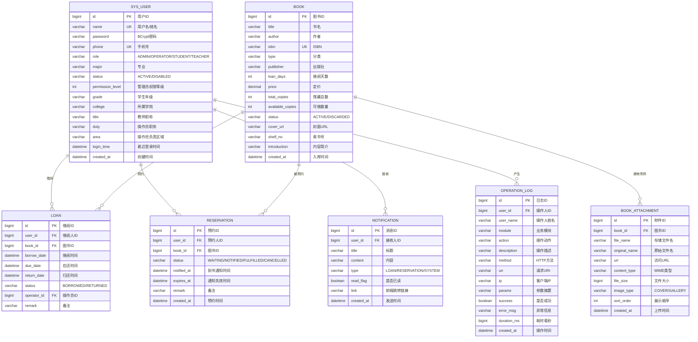

# SpringbootLibrary2026 数据库 E-R 图与表设计

## 1. E-R 图

> 图片版：[docs/er-diagram.png](er-diagram.png)；可视化源文件：[docs/er-diagram.html](er-diagram.html)。



## 2. 表关系说明

| 关系 | 基数 | 说明 |
| --- | --- | --- |
| `sys_user` → `loan` | 1 : N | 一个用户可以有多条借阅记录 |
| `sys_user` → `reservation` | 1 : N | 一个用户可以预约多本图书 |
| `sys_user` → `notification` | 1 : N | 一个用户可以接收多条消息 |
| `sys_user` → `operation_log` | 1 : N | 一个用户会产生多条操作日志 |
| `book` → `loan` | 1 : N | 一本图书可被多次借阅，产生多条历史记录 |
| `book` → `reservation` | 1 : N | 一本图书可被多位读者预约排队 |
| `book` → `book_attachment` | 1 : N | 一本图书拥有封面和多张相关图片 |

## 3. 关键设计说明

### 3.1 图书副本数量

系统不单独建立“副本表”，而是在 `book` 表中维护：

- `total_copies`：馆藏总副本数；
- `available_copies`：当前可借副本数。

借书时 `available_copies - 1`，还书时 `available_copies + 1`，编辑馆藏数量时按“未归还借阅数”重新计算可借数。借书操作使用 `PESSIMISTIC_WRITE` 行锁，避免并发下超借。

### 3.2 附件表设计

`book_attachment` 采用一对多设计：

- `image_type = COVER`：封面，最多一张；
- `image_type = GALLERY`：相关图片，最多 12 张；
- `sort_order` 控制图集顺序；
- `url` 保存 `/uploads/covers/xxx` 或 `/uploads/gallery/xxx` 相对路径；
- `book.cover_url` 冗余封面地址，列表分页查询不需要 JOIN 附件表。

上传新封面时先删除旧封面文件与旧附件记录；删除图书时先删除全部附件文件，再删除附件记录与图书。

### 3.3 预约状态机

```text
WAITING（排队中）
   │ 出现可借副本，系统通知
   ▼
NOTIFIED（已通知，48 小时内有效）
   │ 读者借阅
   ▼
FULFILLED（已借出）

WAITING / NOTIFIED ──读者或管理员取消──► CANCELLED（已取消）
```

### 3.4 操作日志

`operation_log` 由 Spring AOP 自动写入，记录模块、动作、请求 URI、IP、参数摘要、执行结果和耗时。日志写入使用独立事务，即使业务方法抛出异常也会保留失败日志。

## 4. 索引设计

- `sys_user.name`、`sys_user.phone`：唯一索引，用于登录与重复注册校验；
- `book.isbn`：唯一索引；
- `loan.user_id`、`loan.book_id`、`loan.status`：借阅查询与统计；
- `reservation.user_id`、`reservation.book_id`、`reservation.status`：预约队列查询；
- `notification.user_id`、`notification.read_flag`：消息中心未读数；
- `operation_log.user_id`、`operation_log.module`、`operation_log.created_at`：日志组合查询；
- `book_attachment.book_id`、`book_attachment.image_type`：封面与图集查询。
